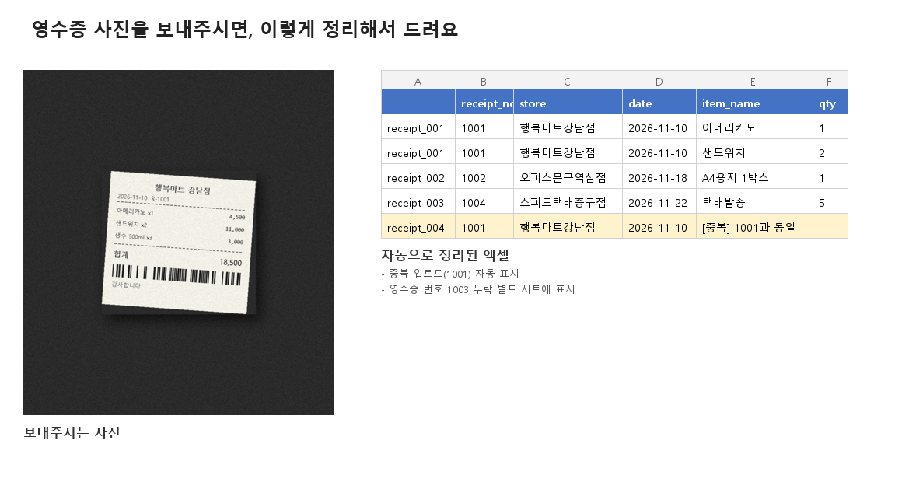
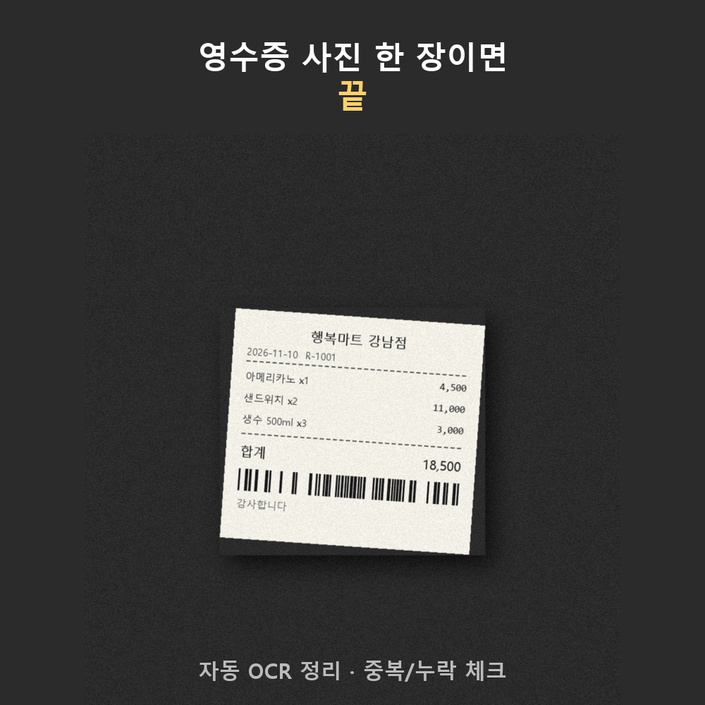

# 영수증 OCR 자동 정리 — 케이스 스터디

영수증/세금계산서 사진을 받아서 날짜·품목·금액이 정리된 엑셀 장부로 자동 변환하는
개인 프로젝트를 진행하면서 정리한 과정과 결과예요.

> 이 저장소는 **진행 과정과 결과를 보여주는 포트폴리오 용도**라, 실제 소스코드는
> 포함하지 않았어요. 사용된 데이터는 전부 데모용으로 직접 만든 가짜 영수증이고,
> 실제 거래 정보는 들어있지 않아요.

## 문제 정의

소상공인·프리랜서들이 매달 쌓이는 영수증을 손으로 엑셀에 옮기는 데 시간을 많이
써요. 특히 아래 두 가지가 반복적으로 놓치기 쉬운 포인트였어요:

- 같은 영수증을 실수로 두 번 업로드/입력하는 경우
- 영수증 번호 순서에 빈 구간이 있는데 (분실된 영수증) 못 알아차리는 경우

## 접근 방법

- **OCR**: Tesseract OCR 엔진(한글 모델 포함)으로 영수증 이미지에서 텍스트 추출
- **구조화**: 추출된 텍스트에서 날짜, 상호, 품목, 수량, 금액, 영수증번호를 파싱
- **검증 로직**:
  - 품목 금액의 합과 영수증에 찍힌 총액을 서로 대조해 오인식 가능성이 있는 건을 표시
  - 동일한 영수증번호가 여러 파일에서 발견되면 중복으로 표시하고, 합계에서 자동 제외
  - 영수증번호를 숫자 순서로 정렬해서 비어있는 번호(분실 가능성이 있는 영수증)를 탐지
- **출력**: 품목 리스트 / 영수증별 요약 / 중복 체크 / 누락 번호 / 전체 합계, 5개 시트로 구성된 엑셀 파일

## 결과 (데모 데이터 기준)

| 항목 | 결과 |
|---|---|
| 처리한 영수증 | 4장 (그중 1장은 의도적으로 중복 업로드) |
| 인식된 품목 | 11건 |
| 금액·수량·날짜 정확도 | 100% (품목 합계 vs 영수증 총액 교차 검증 통과) |
| 중복 탐지 | 정확히 탐지 (영수증번호 1001이 2개 파일에서 중복 발견) |
| 누락 번호 탐지 | 정확히 탐지 (1001, 1002, 1004는 있는데 1003이 빠진 것을 확인) |

품목명(상품 이름) 텍스트는 인쇄 상태에 따라 가끔 오인식이 있었어요(예: "생수" →
"Ads"). 반면 금액/수량/날짜 같은 숫자 데이터는 전부 정확하게 추출됐고, 이 프로젝트는
처음부터 "돈과 직결되는 숫자의 정확도"를 우선순위로 두고 설계했어요.

## 배운 점

- OCR은 완벽하지 않은 게 기본값이라, 사람이 일일이 검수하지 않아도 되도록
  **교차 검증 로직**(합계 대조, 중복/누락 탐지)을 설계에 포함하는 게 핵심이었어요.
- 영수증 사진처럼 "실제 사용 환경"을 흉내 낸 테스트 데이터(회전, 종이 질감, 조명)를
  직접 만들어보니, 깨끗한 디지털 이미지와 실제 사진은 인식률 차이가 크다는 걸 체감했어요.

## 사용 기술

Python, Tesseract OCR, pandas, openpyxl — [Claude Code](https://claude.com/claude-code)로
함께 개발했어요.

## 이미지

| Before → After | 대표 이미지 |
|---|---|
|  |  |

데모용으로 만든 가짜 영수증 샘플:

